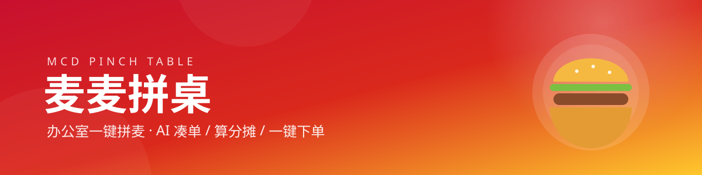
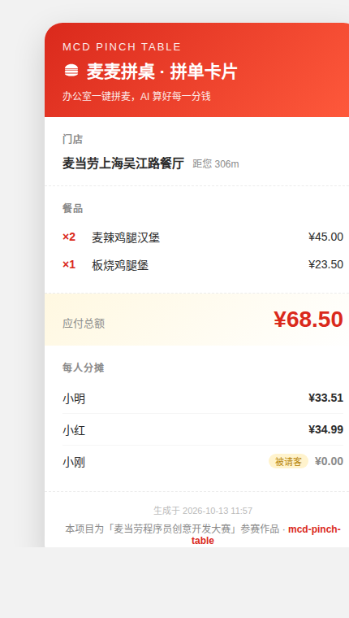
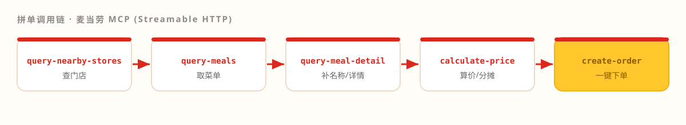

<div align="center">
  
</div>

<div align="center">

**办公室一键拼麦 —— AI 帮你凑最优组合、算好每人分摊、自动下单**


</div>

> 🏆 本项目参加 **「麦当劳程序员创意开发大赛」**（1024 程序员节）。
> 如果它帮你省下一顿饭钱，欢迎点一颗 ⭐ **Star**，让更多打工人告别"拼单算账地狱"！

---

## 📸 效果预览

<div align="center">
  
</div>

> 以上为 **真实运行结果**：上海吴江路餐厅 · 3 人拼单 · 应付 **¥68.50** ·
> 分摊 小明 ¥33.51 / 小红 ¥34.99 / 小刚 ¥0.00（被请客）。

## 😫 痛点：你可能也经历过

| 场景 | 现状 |
|---|---|
| 群里点麦当劳 | "帮我带个巨无霸""不要生菜""再加个可乐"刷屏几十条，**最后没人算得清谁该付多少** |
| 优惠券 | 不知道今天有什么券、能不能叠加、什么时候过期 |
| 会员积分 | 每次都忘了用，**眼睁睁看着它过期** |

## ✨ 麦麦拼桌做什么

| 能力 | 说明 |
|---|---|
| 🧑🤝🧑 **多人拼单** | 一句话描述谁要吃什么，自动汇总成一张订单 |
| 💰 **真实算价** | 调用 `calculate-price`，含配送费、优惠抵扣、应付总额（精确到分） |
| 🧾 **自动分摊** | 按各人商品金额**按比例分摊优惠后总价**，支持"这单我请"（被请客自动转移给他人） |
| 🚀 **一键下单** | 到店自取 / 堂食 / 外带，生成订单与支付链接 |
| 🤖 **自动化管家** | 定时任务自动领券、播报当月活动、提醒临期积分 |
| 📸 **分享卡片** | 一键把拼单结果生成可截图转发的卡片，**群里转发即裂变** |

## 🚀 快速开始

**1️⃣ 拿到麦当劳 MCP Token（免费）**

打开 [open.mcd.cn/mcp](https://open.mcd.cn/mcp) → 手机号登录 → 点右上角「控制台」→ 点「激活」→ 复制 Token。

**2️⃣ 配置环境变量**

```bash
export MCD_MCP_TOKEN="你的 Token"        # Windows: set MCD_MCP_TOKEN=你的Token
```

**3️⃣ 跑起来**（零第三方依赖，只需 Python 3.9+）

```bash
cd src

# 列出麦当劳 MCP 全部可用工具（实测 35 个）
python3 cli.py tools

# 查附近门店
python3 cli.py stores "南京西路" --city 上海

# 办公室拼单（默认 dry-run，只算价、不下单）
python3 cli.py pinch "南京西路" --city 上海 \
  --people "小明:麦辣鸡腿汉堡,小红:板烧鸡腿堡,小刚:麦辣鸡腿汉堡*"

# 生成拼单分享卡片（可直接截图发群）
python3 cli.py share "南京西路" --city 上海 \
  --people "小明:麦辣鸡腿汉堡,小红:板烧鸡腿堡,小刚:麦辣鸡腿汉堡*" --out card.html

# 麦麦自动日报（自动领券 + 活动 + 积分）
python3 cli.py report
```

> 💡 `--people` 语法：`姓名:餐品1+餐品2`，名字后加 `*` 表示**被请客**。
> 加 `--confirm` 才会**真实下单**（默认 dry-run 安全模式）。

## 🖥️ 真实输出示例

```
=== 拼单结果 ===
门店：麦当劳上海吴江路餐厅  [storeCode=1450118]

[餐品]
  2 × 麦辣鸡腿汉堡  ¥45.0
  1 × 板烧鸡腿堡    ¥23.5

应付总额：¥68.5   优惠：¥0.0

[分摊]
  小明：¥33.51
  小红：¥34.99
  小刚：¥0.0（被请客）
```

## 🔧 它是怎么工作的

<div align="center">
  
</div>

本项目通过 **Streamable HTTP** 直连麦当劳中国 MCP，五步完成拼单；自动化管家另用
`auto-bind-coupons` · `campaign-calendar` · `query-my-account` · `query-my-coupons`。

实现细节见 [MCP_INTEGRATION.md](./MCP_INTEGRATION.md)。

## 👥 目标用户

- **办公室打工人**：每天中午要拼单，却总在算账上翻车；
- **麦门忠实用户**：想薅满每一张券、不让积分过期；
- **小团队 / 活动组织者**：给一群人点麦当劳是件苦差事。

## 🧩 项目结构

```
mcd-pinch-table/
├── README.md                  # 本文件
├── MCP_INTEGRATION.md         # MCP 接入说明
├── CONTEST_DECLARATION.md     # 参赛声明（官方原件，未改动）
├── mcp-config.example.json    # 脱敏配置示例（仅环境变量占位）
├── workbuddy.md               # WorkBuddy 开发上下文
├── SKILL.md                   # WorkBuddy Skill 定义
├── src/
│   ├── mcd_client.py          # 麦当劳 MCP 客户端（零依赖，含 SSE/JSON 解析）
│   ├── pinch.py               # 拼单与分摊核心逻辑
│   ├── autopilot.py           # 自动化管家（领券/活动/积分）
│   ├── share_card.py          # 分享卡片渲染
│   └── cli.py                 # 命令行入口
├── config/example.yaml        # 配置示例
└── docs/
    ├── banner.svg             # 项目 banner
    ├── flow.svg               # 调用链示意图
    ├── pinch-card-demo.*      # 分享卡片示例
    └── signup-issue.md        # 报名 Issue 文案
```

## ❓ FAQ

<details>
<summary><b>Token 从哪里来？收费吗？</b></summary>
<br>
麦当劳官方开放平台 <a href="https://open.mcd.cn/mcp">open.mcd.cn/mcp</a> 申请，手机号登录即可，<b>免费</b>。
每个 Token 每分钟最多 600 次请求。
</details>

<details>
<summary><b>会不会不小心真下单了？</b></summary>
<br>
不会。所有下单操作默认 <b>dry-run</b>（只算价），必须显式加 <code>--confirm</code> 才会创建订单，
且订单只返回<b>支付链接</b>，付款仍需你本人操作。
</details>

<details>
<summary><b>支持外送 / 团餐吗？</b></summary>
<br>
当前版本聚焦<b>到店自取</b>（最成熟的场景）。外送、企业团餐所需的
<code>delivery-*</code> / <code>query-meal-assistance</code> 等工具已在代码层预留，欢迎 PR 扩展。
</details>

## ⚠️ 免责声明

本项目为「麦当劳程序员创意开发大赛」参赛作品，由参赛者独立开发，**非麦当劳官方产品**。
项目输出仅供参考，不构成任何专业建议；餐品信息、价格及供应状态**以麦当劳官方渠道的实时结果为准**。
下单前请自行确认门店、餐品与价格，避免误操作。

## 📄 License

[MIT](./LICENSE) · 欢迎 Star ⭐ 与 PR

<div align="center"><sub>Made with 🍟 for the 1024 Programmers' Day</sub></div>
